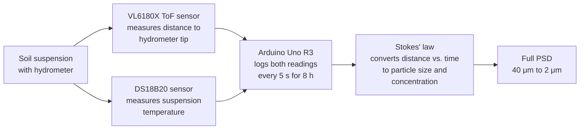

# Automated Hydrometer for Soil Particle-Size Analysis

**A low-cost (< $70) system that automates the hydrometer test, measuring a soil's full particle-size distribution from 40 μm down to 2 μm in 8 hours with no manual readings.**

---

## Overview

Particle-size distribution (PSD) affects many physical, chemical, and biological properties of soil.

| Method | Pros | Cons |
|---|---|---|
| **Hydrometer test** | Inexpensive setup, simple to use, most widely used | Needs manual readings for high-resolution PSDs |
| **X-ray, γ-ray attenuation, laser diffraction** | Automatic and faster than sedimentation methods | Very high equipment cost |
| **This project** | Automatic, high-resolution, under $70 in hardware | Takes 8 hours per sample |

**Goal:** develop an automated method, based on the hydrometer test, that measures a wide range of soil PSDs.

---

## How It Works

1. **Baseline:** An initial distance between the sensor and the hydrometer tip is recorded. It is used as the reference for converting distance over time into particle size and concentration.
2. **Settling:** As soil particles settle, the hydrometer sinks. The time-of-flight sensor tracks the distance to its tip throughout an 8-hour run.
3. **Temperature:** A waterproof DS18B20 measures the suspension temperature at the same time. Temperature affects water viscosity, so it feeds into the calculation.
4. **Logging:** The Arduino records distance and temperature every **5 seconds**.
5. **Conversion:** Stokes' law converts the readings to particle diameter:

$$D = \sqrt{\frac{18\,\eta}{(\rho_s - \rho_w)\,g} \cdot \frac{h}{t}}$$

where $D$ is particle diameter, $\eta$ is water viscosity (from the measured temperature), $\rho_s$ and $\rho_w$ are the densities of soil particles and water, $g$ is gravitational acceleration, $h$ is the hydrometer's effective depth, and $t$ is elapsed time.

---

## Hardware

| Component | Role |
|---|---|
| **Adafruit VL6180X** time-of-flight distance ranging sensor | Measures the distance from the sensor to the hydrometer tip |
| **DS18B20** waterproof 1-Wire digital temperature sensor | Measures suspension temperature |
| **Arduino Uno R3** | Reads both sensors and logs data at 5-second intervals |
| Standard soil hydrometer and sedimentation cylinder | The existing hydrometer-test setup being automated |

**Total automation hardware cost: under $70 USD**

---

## Specifications

| Parameter | Value |
|---|---|
| Particle-size range | 40 μm to 2 μm |
| Run time per sample | 8 hours |
| Sampling interval | 5 seconds |
| Hardware cost | < $70 USD |

---

## Results

The system was tested on **10 soil samples** with different textures and validated against the standard **pipette method**.

The percentages of particles finer than **2, 5, 10, 20, and 40 μm** from the two methods were highly correlated:

| Metric | Value |
|---|---|
| R² range across size classes | **0.857 to 0.896** |

**Conclusion:** the automated system provides an easy, efficient, and cost-effective way to measure soil PSD.

---

## Reference

This project is based on the following published study:

> *[Authors]. [Paper title]. [Journal], [Year]. [DOI link]*
